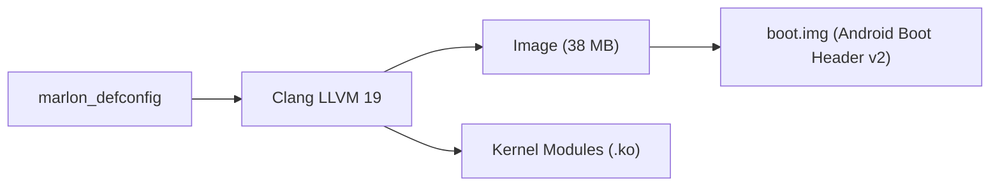

<!--
# File: README.md
# Author: kelexine <https://github.com/kelexine>
# Date: 2026-10-14
# Purpose: Documentation and build guide for Cubot P50 (marlon) downstream Linux 4.19 kernel
-->

# android_kernel_cubot_mt6765

> Downstream Linux 4.19 kernel for the Cubot P50 (marlon / MediaTek MT6765 / MT6762R).

## What is this?
This repository contains the downstream Linux 4.19.127 kernel source for the Cubot P50 smartphone (board name `v956`, codename `marlon`), powered by the MediaTek MT6765 (Helio P35 / MT6762R) SoC. It provides unified hardware support for Android 16 (Baklava) / LineageOS 23.2 while retaining full compatibility with stock Cubot vendor firmware and proprietary blobs.

## Features
- **Vendor Neutralization**: Stripped proprietary ColorOS telemetry, project detection, and power throttling hooks, restoring generic MediaTek subsystems.
- **WALT Scheduler**: Window-Assisted Load Tracking (`CONFIG_SCHED_WALT=y`) tuned for MT6765 big.LITTLE octa-core topology, with ColorOS UIFIRST wrappers cleanly eliminated.
- **Display & Backlight**: Stock PWM LED backlight driver (`mtk_leds.c`) integrated with custom AIDL Light HAL support and MT6357 PMIC notification indicator control.
- **OV5670 Camera Bringup**: Restored stock MTK camera subsystem and implemented OV5670 MIPI RAW sensor driver for the Cubot P50 front camera.
- **BPFFS & Modern Android Networking**: Backported eBPF per-file labeling, cgroup-bpf, and clsact hooks for Android 14+ netd and BPF network token monitoring.
- **Clang 18 / 19 Compilation**: Fully builds with Clang/LLVM (`LLVM=1 LLVM_IAS=1`) with zero compiler warnings-as-errors.

## Building the Kernel

### Prerequisites
- Python 3.10+
- Clang / LLVM 18+ toolchain (e.g. Android NDK r29 or AOSP prebuilt Clang)
- `bc`, `bison`, `flex`, `libssl-dev`, `libelf-dev`, `pahole`

### Workspace Layout & Required Symlinks
For cross-module header resolution (`$(TOP)/vendor/...`) and out-of-tree connectivity compilation, place the kernel and modules repositories side-by-side and set up the top-level `vendor` symlink:

```
workspace/
├── android_kernel_cubot_mt6765/          # This kernel repository
├── android_kernel_modules_cubot_mt6765/  # Out-of-tree modules repository
└── vendor -> android_kernel_modules_cubot_mt6765/source/vendor
```

Create the symlink from your workspace root:
```bash
ln -sfn android_kernel_modules_cubot_mt6765/source/vendor vendor
```

### Manual Compilation Guide
Export your cross-compilation environment and LLVM toolchain:

```bash
export ARCH=arm64
export SUBARCH=arm64
export CLANG_TRIPLE=aarch64-linux-gnu-
export CROSS_COMPILE=aarch64-linux-gnu-
export LLVM=1
export LLVM_IAS=1
export PATH="<path-to-llvm-bin>:${PATH}"

# 1. Generate kernel configuration from marlon_defconfig
make -C android_kernel_cubot_mt6765 O=out marlon_defconfig

# 2. Build kernel binary (Image) and Device Tree Blobs (dtbs)
make -C android_kernel_cubot_mt6765 O=out -j$(nproc) Image dtbs

# 3. Build in-tree kernel modules (kheaders.ko, trace_mmstat.ko)
make -C android_kernel_cubot_mt6765 O=out -j$(nproc) modules
```

The compiled kernel image is output to `out/arch/arm64/boot/Image`.

## Architecture


## Contributing
- **Branch**: `marlon-bringup`
- **Commits**: Follow [Conventional Commits](https://www.conventionalcommits.org/) (`feat(p50): ...`, `kernel(marlon): ...`, `fix(sched): ...`).
- All changes must be signed off: `Signed-off-by: Author <email>`.

## License
GPL-2.0-only
