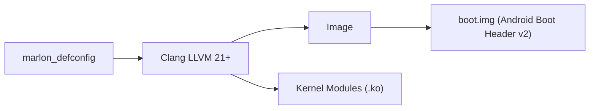

# android_kernel_cubot_mt6765

> Downstream Linux 4.19-CIP LTS kernel for the Cubot P50 (marlon / MediaTek MT6765 / MT6762R).

## What is this?
This repository contains the downstream Linux 4.19.325-cip (Civil Infrastructure Platform LTS) kernel source for the Cubot P50 smartphone (board name `v956`, codename `marlon`), powered by the MediaTek MT6765/MT6762 (Helio P35 / MT6762R) SoC. It provides unified hardware support for Android 14 through Android 16 (LineageOS 21–23) while retaining full compatibility with stock Cubot vendor firmware and hardware subsystems.

## Building the Kernel

### Prerequisites
- Python 3.10+
- Clang / LLVM 21+ toolchain (`LLVM=1 LLVM_IAS=1`), Android NDK r30
- `bc`, `bison`, `flex`, `libssl-dev`, `libelf-dev`, `pahole`

### Compilation Guide
Export your cross-compilation environment and LLVM toolchain:

```bash
export ARCH=arm64
export SUBARCH=arm64
export CLANG_TRIPLE=aarch64-linux-gnu-
export CROSS_COMPILE=aarch64-linux-gnu-
export LLVM=1
export LLVM_IAS=1
export PATH="<path-to-llvm-21-bin>:${PATH}"

# 1. Generate kernel configuration from marlon_defconfig
make -C android_kernel_cubot_mt6765 O=out marlon_defconfig

# 2. Build kernel binary (Image) and Device Tree Blobs (dtbs)
make -C android_kernel_cubot_mt6765 O=out -j$(nproc) Image dtbs

# 3. Build kernel modules
make -C android_kernel_cubot_mt6765 O=out -j$(nproc) modules
```

The compiled kernel image is output to `out/arch/arm64/boot/Image`.

## Architecture


## Contributing
- **Branches**:
  - `marlon-cip`: Primary stable branch tracking Linux 4.19-CIP LTS and Android modernizations.
  - `marlon`: Downstream vendor stock baseline.

## License
GPL-2.0-only
